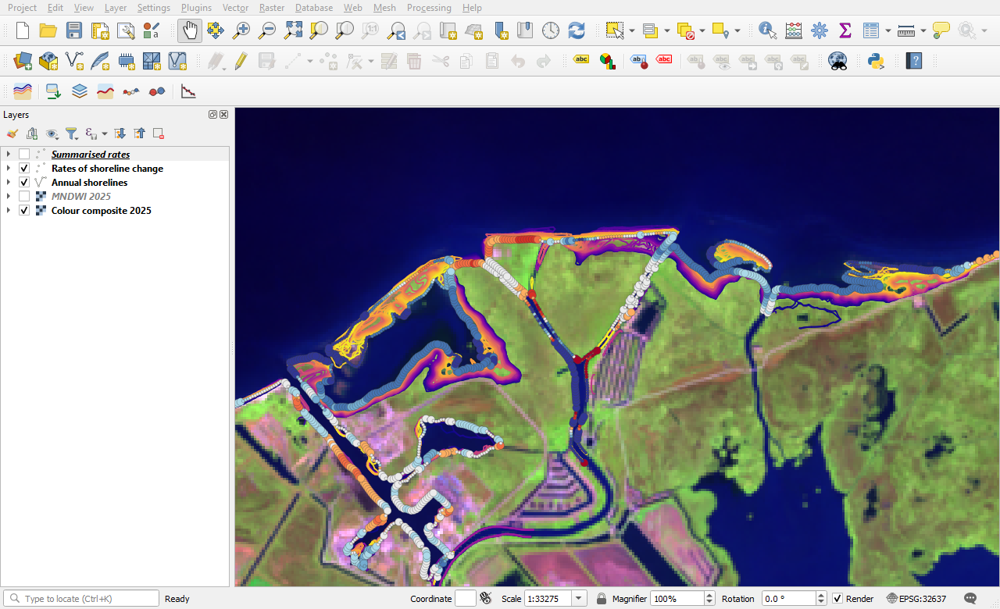
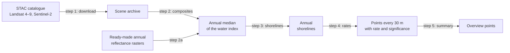
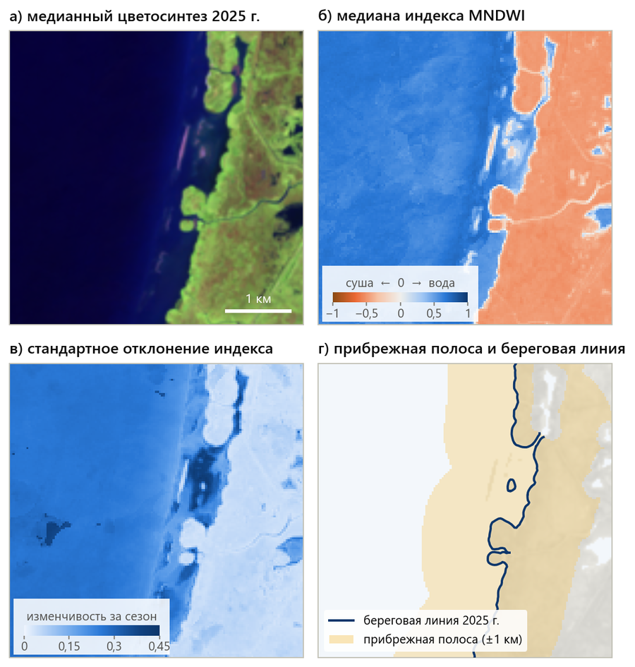
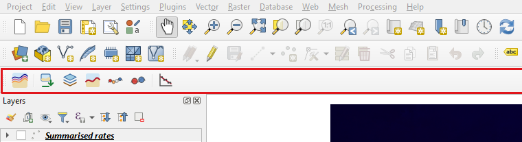
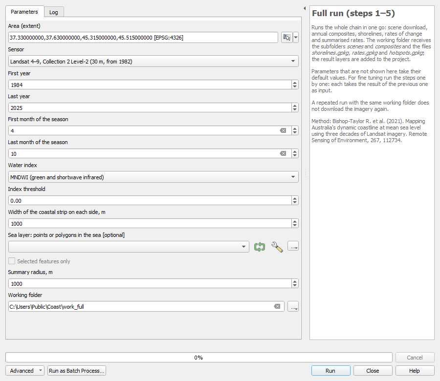
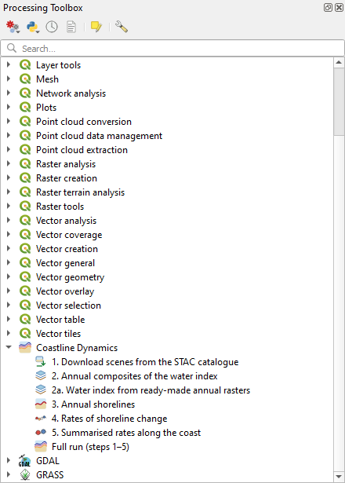
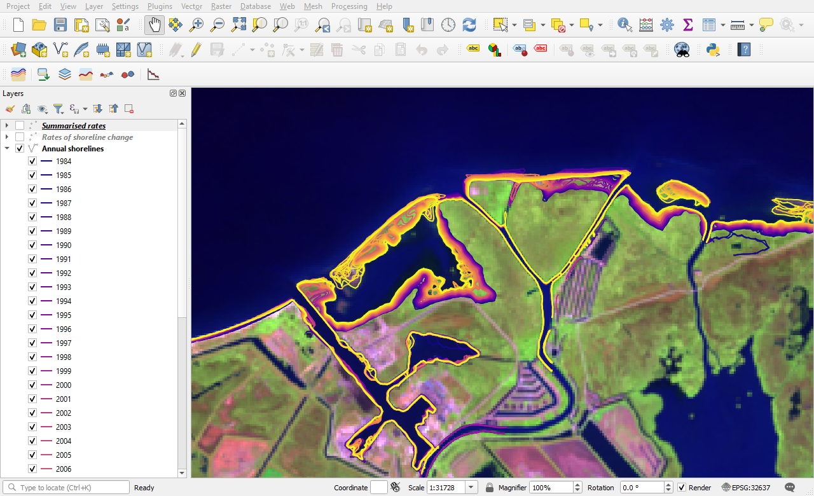
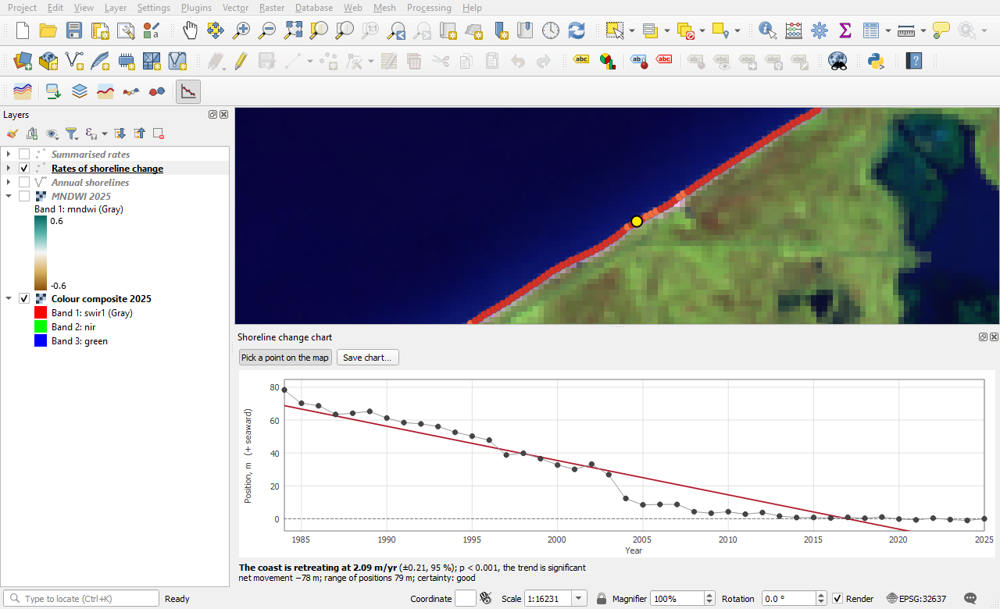
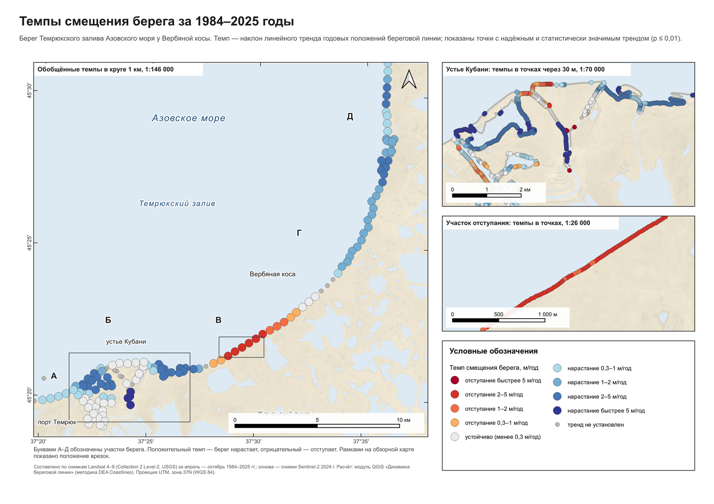
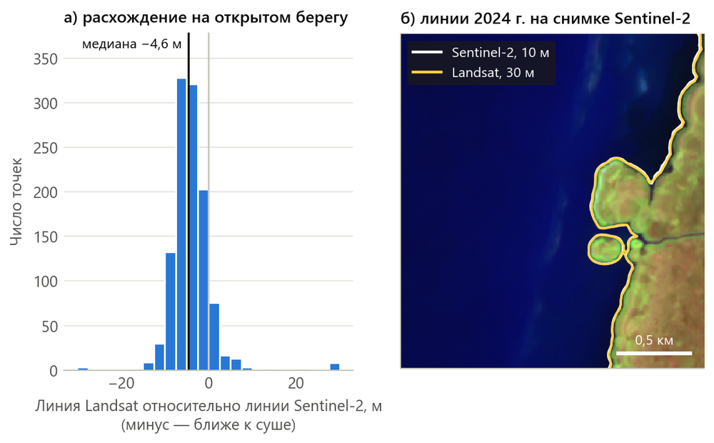

# Coastline Dynamics (Динамика береговой линии)

[Русский](README.md) · **English**


A QGIS plugin that maps the shoreline of every year from long Landsat and Sentinel-2 time series and measures
how fast the coast is retreating or growing. The method follows
[Digital Earth Australia Coastlines](https://github.com/GeoscienceAustralia/dea-coastlines)
(Bishop-Taylor et al., 2021).

The plugin finds and downloads the imagery itself from the open Microsoft Planetary Computer catalogue; no
account is needed. Nothing extra has to be installed: the calculation relies on numpy, scipy and GDAL, which
ship with QGIS.

The interface is available in English and Russian and follows the language of QGIS.



*The result in QGIS: shorelines for 1984–2025 (dark to light) and rates of change at points every 30 m.
Mouth of the Kuban River, Sea of Azov.*

## What it does

- **Downloads imagery** for the chosen area: Landsat 4–9 (30 m, from 1982) or Sentinel-2 (10 m, from 2015).
  Clouds, shadows and snow are masked. A repeated run fetches only what is missing.
- **Builds annual composites** of the MNDWI or NDWI water index: the per-pixel median, standard deviation and
  number of observations.
- **Draws the shoreline** of every year at sub-pixel precision and separates the sea from lagoons, estuaries
  and rivers.
- **Computes the rate of change** at points every 30 m: the slope of a linear trend, its significance and a
  certainty flag.
- **Summarises the rates** along stretches of coast for overview maps.
- **Plots** the shoreline position by year for any point.

Every step is a separate Processing algorithm, so the workflow can be run in batch mode, used in the model
designer and called from Python.

## How it works



| Step | What it does | Output |
|---|---|---|
| 1. Download scenes from the STAC catalogue | Finds the scenes over the area and saves clips of three reflectance bands | Archive folder: one file per acquisition day and a `scenes.csv` table |
| 2. Annual composites of the water index | Computes the per-pixel annual median of the index and fallback three-year composites | `mndwi_YYYY.tif`, `mndwi_YYYY_gapfill.tif`, `rgb_YYYY.tif` |
| 2a. Water index from ready-made annual rasters | Replaces steps 1 and 2 when annual reflectance composites already exist | The same index files |
| 3. Annual shorelines | Restricts the analysis to a coastal strip and draws the shoreline of every year | Line layer with `year` and `certainty` fields |
| 4. Rates of shoreline change | Measures the position of every year's shoreline relative to the baseline year and fits a trend | Point layer: `rate_time`, `sig_time`, `dist_YYYY` |
| 5. Summarised rates along the coast | Reduces point rates to the median within a circle of a given radius | Point layer for small scales |
| Full run (steps 1–5) | Runs the whole chain in one go | All of the above in one working folder |

<p align="center"></p>

*The stages on one stretch of coast (figure labels are in Russian): (а) median colour composite of the
year, (б) MNDWI median, (в) its variability within the season, (г) the coastal strip and the resulting
shoreline.*

## Installation

QGIS 3.22 or newer is required. The plugin has been tested in QGIS 3.38 on Windows only.

The plugin folder inside the QGIS profile must be named `coastline_dynamics`.

**With git.** Open the plugins folder of your profile and clone the repository into it:

```
git clone https://github.com/EvgenieLebedev/coastline_dynamics.git
```

**Without git.** On the repository page click **Code → Download ZIP**, unpack the archive, rename the folder
`coastline_dynamics-main` to `coastline_dynamics` and move it into the plugins folder.

Where the plugins folder is:

| System | Path |
|---|---|
| Windows | `%APPDATA%\QGIS\QGIS3\profiles\default\python\plugins` |
| Linux | `~/.local/share/QGIS/QGIS3/profiles/default/python/plugins` |
| macOS | `~/Library/Application Support/QGIS/QGIS3/profiles/default/python/plugins` |

The profile folder opens from **Settings → User Profiles → Open Active Profile Folder**; plugins live in its
`python/plugins` subfolder.

Then restart QGIS, open **Plugins → Manage and Install Plugins… → Installed** and tick
**Coastline Dynamics**. The plugin toolbar and an entry in the **Plugins** menu appear.



*Buttons from left to right: full run, steps 1–5, point chart.*

## First run

1. Zoom the map to your area so that the window shows the coast, open sea and some land.
2. Click **Full run (steps 1–5)**.
3. In **Area (extent)** click the button on the right and choose *Use Current Map Canvas Extent*.
4. Set the years and the season. For seas that freeze, use ice-free months only.
5. Choose the **Working folder** and click **Run**.

<p align="center"></p>

The working folder receives the subfolders `scenes` and `composites` and the files `shorelines.gpkg`,
`rates.gpkg` and `hotspots.gpkg`. The result layers are added to the project already styled.

In our example (a 24 × 23 km area, 42 years) the run took 20–30 minutes, of which 15–17 minutes were the
download. The scene archive for such an area takes 1.25 GB.

## Algorithms

The algorithms are in the Processing Toolbox, in the **Coastline Dynamics** group.

<p align="center"></p>

| Algorithm | Identifier |
|---|---|
| 1. Download scenes from the STAC catalogue | `coastdyn:download_scenes` |
| 2. Annual composites of the water index | `coastdyn:annual_composites` |
| 2a. Water index from ready-made annual rasters | `coastdyn:index_from_rasters` |
| 3. Annual shorelines | `coastdyn:annual_shorelines` |
| 4. Rates of shoreline change | `coastdyn:rates_of_change` |
| 5. Summarised rates along the coast | `coastdyn:hotspots` |
| Full run (steps 1–5) | `coastdyn:full_pipeline` |

Calling it from the QGIS Python console:

```python
import processing

processing.run("coastdyn:full_pipeline", {
    "EXTENT": "37.33,37.63,45.315,45.515 [EPSG:4326]",   # west, east, south, north
    "SENSOR": 0,                # 0 = Landsat 4–9, 1 = Sentinel-2
    "YEAR_FROM": 1984, "YEAR_TO": 2025,
    "MONTH_FROM": 4, "MONTH_TO": 10,
    "INDEX": 0,                 # 0 = MNDWI, 1 = NDWI
    "THRESHOLD": 0.0,           # water is above the threshold
    "BUFFER": 1000,             # width of the coastal strip on each side, m
    "RADIUS": 1000,             # summary radius, m
    "FOLDER": "C:/work/coast",
})
```

The parameters of each algorithm are described in the right-hand part of its dialog.

## Reading the result



*The “Annual shorelines” layer: every line is coloured by year.*

Fields of the “Rates of shoreline change” layer:

| Field | Meaning |
|---|---|
| `rate_time` | Rate, m/yr. Negative means the coast is retreating, positive means it is growing |
| `sig_time` | Significance of the trend: the probability of getting such a slope by chance. The trend is treated as established at 0.01 or less |
| `se_time` | Standard error of the rate, m/yr |
| `outl_time` | Years excluded from the trend as outliers |
| `dist_YYYY` | Position of the year's shoreline relative to the baseline year, m. Positive is seaward, negative is landward |
| `nsm` | Net movement over the whole period, m |
| `sce` | Range of positions over the period, m |
| `certainty` | Certainty: `good` or the reason for doubt |

On the map, large symbols mark points where both `certainty = good` and `sig_time ≤ 0.01`. Red tones mean
retreat, blue tones mean growth.

| `certainty` value | Meaning |
|---|---|
| `good` | No remarks |
| `insufficient data` (lines) | Fewer than five observations in the year along this part of the line |
| `unstable data` (lines) | Standard deviation of the index above 0.3: the waterline moved noticeably within the season |
| `baseline outlier` | The shoreline of the baseline year is itself an outlier |
| `high angular variability` | Shorelines of different years lie in different directions: the coast is complex and a trend along one axis is undefined |
| `insufficient observations` | A distance was obtained for fewer than 75 % of the years |
| `extreme value` | Rate above 50 m/yr: more likely a failure than a real change |
| `insufficient points` (summary) | Too few source points fell inside the circle |

### Point chart

The **Shoreline change chart for a point** button opens a panel. Click **Pick a point on the map** and then
a point of the rates layer: the panel shows the shoreline positions by year, the trend line and a summary.
Hollow circles are years excluded from the trend.



## Example: the coast near Verbyanaya Spit

The plugin was worked through on a stretch of the Temryuk Bay coast of the Sea of Azov near Verbyanaya Spit
(24 × 23 km).

| Indicator | Value |
|---|---|
| Period and season | 1984–2025, April to October |
| Imagery | 1,114 Landsat observations out of 1,325 found; 1.25 GB archive |
| Shorelines | 42 years, median length 66 km |
| Rate points | 2,386, of which 1,918 reliable and 1,557 with a significant trend |
| Median rate at points with a significant trend | +0.95 m/yr |
| Coast growing | 31.0 km |
| Coast retreating | 10.7 km |
| No significant trend | 10.8 km |

North-east of the Kuban mouth the coast is retreating: the median rate on that stretch is −1.48 m/yr.
Further along the spit it grows by 1.2–1.7 m/yr.



*The final map, composed in a QGIS print layout from the plugin layers (map text is in Russian). Red
circles mark retreat, blue circles mark growth; the main map shows rates summarised within 1 km, the
insets show rates at points.*

## Validation

- **Synthetic data.** On artificial composites with a prescribed shoreline movement of +2.00 and −1.50 m/yr
  the plugin returned medians of +2.00 and −1.50 m/yr. The line position was recovered with an RMSE of 1.0 m.
- **Independent recomputation.** Distances and slopes were recomputed with different code (shapely, scipy)
  at 300 points, 12,600 point–year pairs. The largest difference was 0.005 m in distance and 0.001 m/yr
  in slope.
- **Comparison with Sentinel-2.** The 2024 shoreline from Landsat (30 m) was compared with the one from
  Sentinel-2 (10 m). On the open coast the RMSE is 7.9 m and the median is −4.6 m: the Landsat line lies
  landward.

<p align="center"></p>

*Left: Landsat line relative to the Sentinel-2 line on the open coast, m (negative is landward).
Right: both 2024 lines over the Sentinel-2 image.*

## Differences from DEA Coastlines

| | DEA Coastlines | This plugin |
|---|---|---|
| Environment | Open Data Cube | QGIS on an ordinary computer, one area per run |
| Imagery | Digital Earth Australia archive | Landsat Collection 2 Level-2 and Sentinel-2 L2A from the Microsoft Planetary Computer catalogue |
| Tides | Tide model, scenes selected by water level | No model. You can supply your own sea level table (CSV), and only scenes taken near the mean level are used |
| Outlier years | Deviation of the "year – distance" pair | The same by default; optionally by residuals from a Theil–Sen line |

The plugin finds the sea by itself: it is the largest permanent water body in the area. If the area contains a
lagoon or estuary of comparable size, the sea is given by a layer with a point in it. For lakes, reservoirs
and ponds, step 3 has the mode “All water bodies wider than 300 m”.

The computational core was rewritten for numpy, scipy and GDAL. Some functions were ported from the
DEA Coastlines source code; the [NOTICE](NOTICE) file lists them and what was changed.

## Limitations

- The plugin shows the boundary between water and land in the imagery. On shallow coasts with tidal flats,
  marshes and reeds it may differ from the shoreline drawn on maps.
- Tides are not modelled. For tidal seas a sea level table is needed.
- A linear trend describes gradual change. One-off events (a breached spit, land reclamation, a storm) are
  smoothed out, so the rate should be checked against the point chart.
- The outlier rule adopted in DEA Coastlines underestimates the rate by about a third at points where the
  coast changes quickly. For such coasts step 4 offers the rule “By trend residuals”.
- Ready-made annual composites (algorithm 2a) must be checked by the user: the number of observations and the
  spread of the index cannot be recovered from them, so the certainty flags of the lines are not computed.
- Step 1 needs an internet connection.

## Repository layout

```
coastline_dynamics/
  core/              computational core: numpy, scipy, GDAL; independent of the QGIS interface
    stac.py          scene search in the STAC catalogue, clip download, local archive
    sensors.py       Landsat C2 L2 and Sentinel-2 L2A: bands, scaling, masks
    composites.py    water index, annual and three-year composites, selection by sea level
    masks.py         sea, coastal strip, temporal mask, rivers, certainty
    contours.py      shoreline as a sub-pixel contour
    rates.py         points along the coast, signed distances, regression, summary
    morph.py         morphological operations
    gridio.py        grid, raster reading and writing
    i18n.py          interface language: Russian or English, chosen from the QGIS language
    i18n_en.py       English interface strings
  algorithms.py      seven Processing algorithms (provider coastdyn)
  styling.py         styling of the result layers
  chart_dock.py      the point chart panel
  plugin.py          menu and toolbar
  provider.py        algorithm provider
  help/              built-in help: index.html (Russian), index_en.html (English)
  icons/             icons
  docs/img/          illustrations for this page (docs/img/en: English interface)
  metadata.txt       plugin metadata for QGIS
  LICENSE            MIT licence
  NOTICE             attribution for the code ported from DEA Coastlines
  LICENSES/          text of the Apache 2.0 licence for the ported code
  CITATION.cff       how to cite the plugin
```

## References

Method:

> Bishop-Taylor R., Nanson R., Sagar S., Lymburner L. (2021). Mapping Australia's dynamic coastline at mean
> sea level using three decades of Landsat imagery. *Remote Sensing of Environment*, 267, 112734.
> https://doi.org/10.1016/j.rse.2021.112734

DEA Coastlines source code: https://github.com/GeoscienceAustralia/dea-coastlines (Apache 2.0 licence).

Data: Landsat Collection 2 Level-2 (USGS) and Sentinel-2 L2A (Copernicus programme) from the
[Microsoft Planetary Computer](https://planetarycomputer.microsoft.com/) catalogue.

## How to cite

If the plugin was useful in your work, please cite it:

> Lebedev E.D. (2026). Coastline Dynamics: a QGIS plugin for annual shorelines and rates of coastal change
> (Version 0.1.0) [Computer software]. https://github.com/EvgenieLebedev/coastline_dynamics

```bibtex
@software{lebedev_coastline_dynamics_2026,
  author  = {Lebedev, E. D.},
  title   = {Coastline Dynamics: a {QGIS} plugin for annual shorelines and rates of coastal change},
  version = {0.1.0},
  year    = {2026},
  url     = {https://github.com/EvgenieLebedev/coastline_dynamics}
}
```

The same information is in [CITATION.cff](CITATION.cff), which GitHub uses for the "Cite this repository"
button. Please cite the method separately, using Bishop-Taylor et al. (2021) from the References section.

## Licence

The plugin is released under the MIT licence, see [LICENSE](LICENSE).

Part of the computational core was ported from the DEA Coastlines source code, which is released under the
Apache 2.0 licence. The [NOTICE](NOTICE) file records this, and the text of the Apache 2.0 licence is in
[LICENSES/Apache-2.0.txt](LICENSES/Apache-2.0.txt). These files must be kept when the plugin is redistributed.

## Author

Lebedev E.D., z.lebedev.1998@yandex.ru. Comments and suggestions are welcome in [Issues](https://github.com/EvgenieLebedev/coastline_dynamics/issues).
