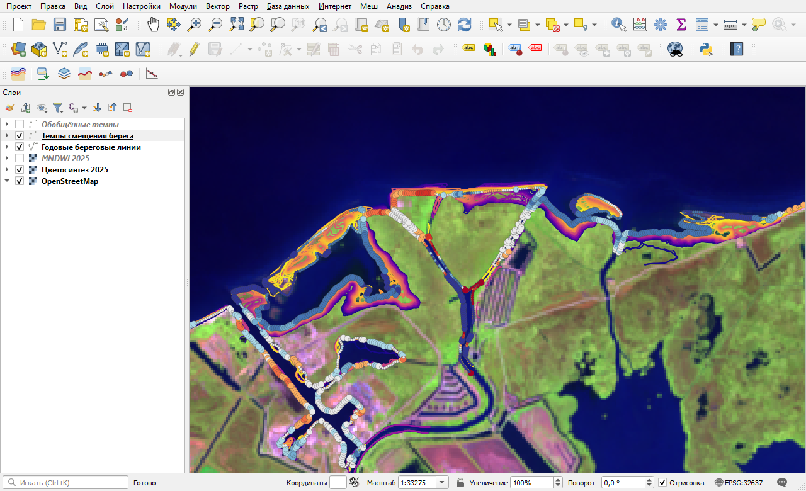
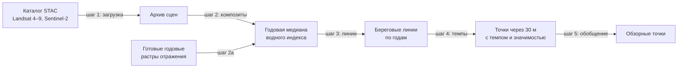
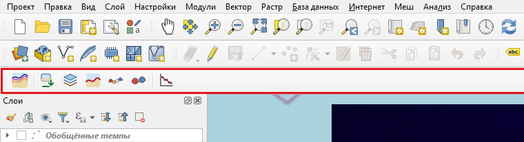
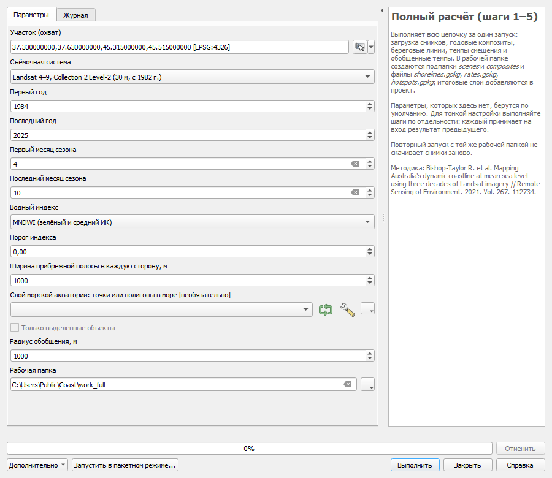
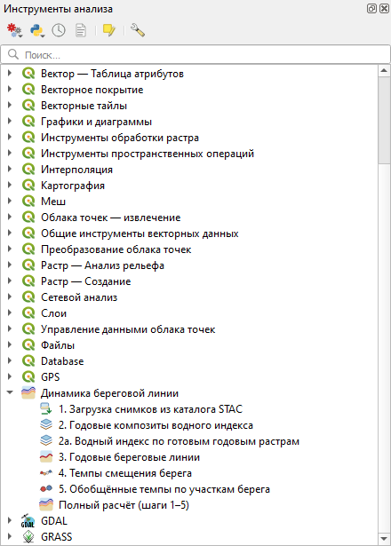
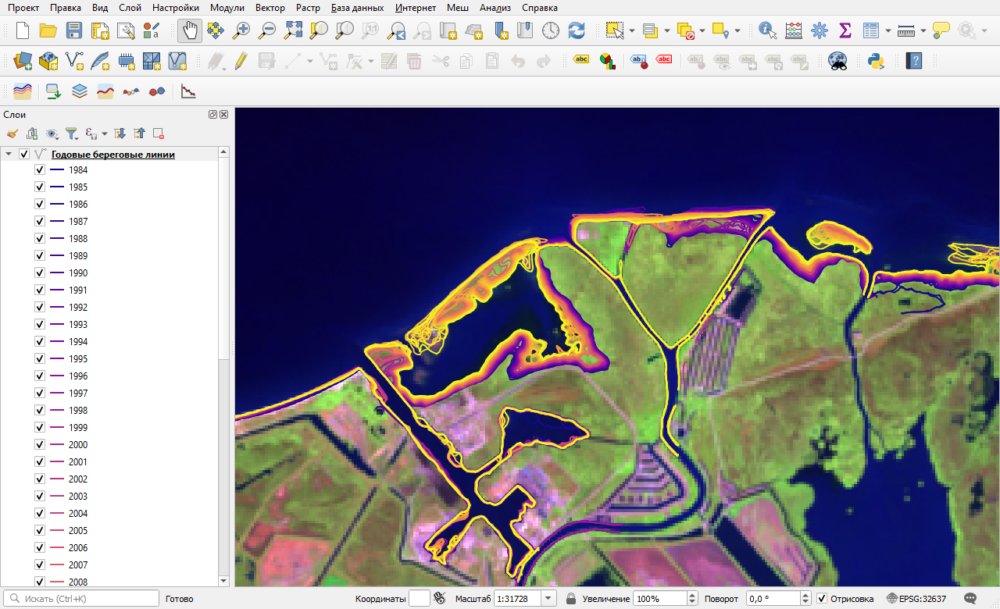
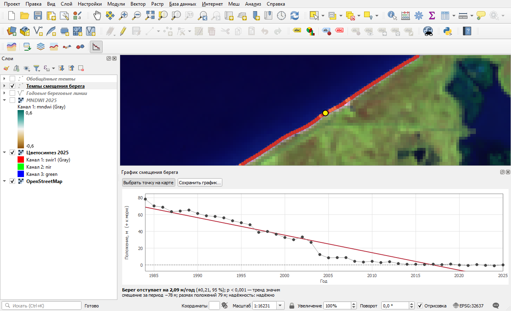

# Динамика береговой линии (Coastline Dynamics)

**Русский** · [English](README.en.md)


Модуль QGIS, который по многолетним рядам снимков Landsat и Sentinel-2 строит береговую линию каждого года
и считает, с какой скоростью берег отступает или нарастает. Методика следует проекту
[Digital Earth Australia Coastlines](https://github.com/GeoscienceAustralia/dea-coastlines)
(Bishop-Taylor et al., 2021).

Снимки модуль сам находит и загружает из открытого каталога Microsoft Planetary Computer, регистрация не нужна.
Дополнительных библиотек ставить не требуется: расчёт опирается на numpy, scipy и GDAL, которые входят в QGIS.



*Результат в окне QGIS: береговые линии 1984–2025 годов (от тёмных к светлым) и темпы смещения берега в точках
через 30 м. Устье Кубани, Азовское море.*

## Что делает модуль

- **Загружает снимки** на выбранный участок: Landsat 4–9 (30 м, с 1982 года) или Sentinel-2 (10 м, с 2015 года).
  Облака, тени и снег маскируются. Повторный запуск докачивает только недостающее.
- **Строит годовые композиты** водного индекса MNDWI или NDWI: медиану, стандартное отклонение и число наблюдений
  для каждого пикселя.
- **Проводит береговую линию** каждого года с подпиксельной точностью и отделяет море от лиманов, лагун и рек.
- **Считает темп смещения берега** в точках через 30 м: наклон линейного тренда, его значимость и признак
  надёжности.
- **Обобщает темпы** по участкам берега для обзорных карт.
- **Показывает график** положения берега по годам для любой точки.

Каждый шаг — отдельный алгоритм панели инструментов анализа. Поэтому расчёт можно запускать в пакетном режиме,
встраивать в построитель моделей и вызывать из Python.

## Как устроен расчёт



| Шаг | Что делает | Результат |
|---|---|---|
| 1. Загрузка снимков из каталога STAC | Находит сцены на участок и сохраняет вырезки трёх каналов отражения | Папка архива: файл на каждый день съёмки и таблица `scenes.csv` |
| 2. Годовые композиты водного индекса | Считает попиксельную медиану индекса за год и запасные трёхлетние композиты | `mndwi_ГГГГ.tif`, `mndwi_ГГГГ_gapfill.tif`, `rgb_ГГГГ.tif` |
| 2а. Водный индекс по готовым годовым растрам | Заменяет шаги 1 и 2, если годовые композиты отражения уже есть | Те же файлы индекса |
| 3. Годовые береговые линии | Ограничивает расчёт прибрежной полосой и проводит линию каждого года | Линейный слой с полями `year`, `certainty` |
| 4. Темпы смещения берега | Измеряет положение линий всех лет относительно опорного года и строит тренд | Точечный слой: `rate_time`, `sig_time`, `dist_ГГГГ` |
| 5. Обобщённые темпы по участкам берега | Сводит точечные темпы к медиане в круге заданного радиуса | Точечный слой для мелких масштабов |
| Полный расчёт (шаги 1–5) | Выполняет всю цепочку за один запуск | Всё перечисленное в одной рабочей папке |

<p align="center"></p>

*Этапы на одном фрагменте берега: медианный снимок года, индекс MNDWI, его изменчивость за сезон и итоговая
береговая линия в прибрежной полосе.*

## Установка

Требуется QGIS 3.22 или новее. Модуль испытан в QGIS 3.38 под Windows; в других версиях и системах не проверялся.

Папка модуля в профиле QGIS должна называться `coastline_dynamics`.

**Через git.** Откройте папку модулей своего профиля и склонируйте репозиторий под нужным именем:

```
git clone <адрес этого репозитория> coastline_dynamics
```

**Без git.** Нажмите на странице репозитория **Code → Download ZIP**, распакуйте архив, переименуйте папку
в `coastline_dynamics` и перенесите её в папку модулей.

Где лежит папка модулей:

| Система | Путь |
|---|---|
| Windows | `%APPDATA%\QGIS\QGIS3\profiles\default\python\plugins` |
| Linux | `~/.local/share/QGIS/QGIS3/profiles/default/python/plugins` |
| macOS | `~/Library/Application Support/QGIS/QGIS3/profiles/default/python/plugins` |

Папку профиля открывает меню **Настройки → Профили пользователей → Открыть каталог текущего профиля**;
модули лежат в ней в подпапке `python/plugins`.

После этого перезапустите QGIS, откройте **Модули → Управление и установка модулей… → Установленные** и поставьте
флажок возле модуля «Динамика береговой линии». Появятся панель инструментов модуля и пункт в меню **Модули**.



*Кнопки слева направо: полный расчёт, шаги 1–5, график точки.*

## Первый расчёт

1. Приблизьте карту к своему участку так, чтобы в окне были и берег, и открытое море, и суша с запасом.
2. Нажмите кнопку **Полный расчёт (шаги 1–5)**.
3. В поле **Участок (охват)** нажмите кнопку справа и выберите **Использовать охват окна карты**.
4. Задайте годы и сезон. Для замерзающих морей берите только безлёдные месяцы.
5. Укажите рабочую папку и нажмите **Выполнить**.

<p align="center"></p>

В рабочей папке появятся подпапки `scenes` и `composites` и файлы `shorelines.gpkg`, `rates.gpkg`,
`hotspots.gpkg`. Итоговые слои добавляются в проект уже оформленными.

В нашем примере (участок 24 × 23 км, 42 года) расчёт занял 20–30 минут, из них 15–17 минут ушло на загрузку
снимков. Архив снимков такого участка занимает 1,25 ГБ.

## Алгоритмы

Алгоритмы находятся в панели инструментов анализа, в группе «Динамика береговой линии».

<p align="center"></p>

| Алгоритм | Идентификатор |
|---|---|
| 1. Загрузка снимков из каталога STAC | `coastdyn:download_scenes` |
| 2. Годовые композиты водного индекса | `coastdyn:annual_composites` |
| 2а. Водный индекс по готовым годовым растрам | `coastdyn:index_from_rasters` |
| 3. Годовые береговые линии | `coastdyn:annual_shorelines` |
| 4. Темпы смещения берега | `coastdyn:rates_of_change` |
| 5. Обобщённые темпы по участкам берега | `coastdyn:hotspots` |
| Полный расчёт (шаги 1–5) | `coastdyn:full_pipeline` |

Пример вызова из консоли Python в QGIS:

```python
import processing

processing.run("coastdyn:full_pipeline", {
    "EXTENT": "37.33,37.63,45.315,45.515 [EPSG:4326]",   # запад, восток, юг, север
    "SENSOR": 0,                # 0 — Landsat 4–9, 1 — Sentinel-2
    "YEAR_FROM": 1984, "YEAR_TO": 2025,
    "MONTH_FROM": 4, "MONTH_TO": 10,
    "INDEX": 0,                 # 0 — MNDWI, 1 — NDWI
    "THRESHOLD": 0.0,           # вода — выше порога
    "BUFFER": 1000,             # ширина прибрежной полосы в каждую сторону, м
    "RADIUS": 1000,             # радиус обобщения, м
    "FOLDER": "C:/work/coast",
})
```

Параметры каждого алгоритма описаны в правой части его диалога.

## Как читать результат



*Слой «Годовые береговые линии»: каждая линия окрашена по году.*

Поля слоя «Темпы смещения берега»:

| Поле | Смысл |
|---|---|
| `rate_time` | Темп, м/год. Отрицательный — берег отступает, положительный — нарастает |
| `sig_time` | Значимость тренда: вероятность получить такой наклон случайно. Тренд считается установленным при значении не больше 0,01 |
| `se_time` | Стандартная ошибка темпа, м/год |
| `outl_time` | Годы, исключённые из расчёта тренда как выпадающие |
| `dist_ГГГГ` | Положение линии года относительно линии опорного года, м. Плюс — мористее, минус — ближе к суше |
| `nsm` | Смещение за весь период, м |
| `sce` | Размах положений за период, м |
| `certainty` | Надёжность: `good` либо причина сомнения |

На карте крупными знаками показаны точки, где одновременно `certainty = good` и `sig_time ≤ 0,01`.
Красные тона означают отступание, синие — нарастание.

| Значение `certainty` | Смысл |
|---|---|
| `good` | Замечаний нет |
| `insufficient data` (линии) | На участке линии меньше пяти наблюдений за год |
| `unstable data` (линии) | Стандартное отклонение индекса больше 0,3: урез в течение сезона заметно перемещался |
| `baseline outlier` | Линия опорного года сама выпадает из ряда |
| `high angular variability` | Линии разных лет лежат в разных направлениях: берег сложной формы, тренд вдоль одной оси не определён |
| `insufficient observations` | Расстояние определено меньше чем для 75 % лет |
| `extreme value` | Темп больше 50 м/год: вероятнее сбой, чем действительное изменение |
| `insufficient points` (обобщение) | В круг попало слишком мало исходных точек |

### График точки

Кнопка **График смещения берега в точке** открывает панель. Нажмите «Выбрать точку на карте» и щёлкните
по точке слоя темпов: появятся ряд положений береговой линии по годам, линия тренда и сводка.
Пустыми кружками показаны годы, исключённые из расчёта тренда.



## Пример: берег у Вербяной косы

Модуль отработан на участке берега Темрюкского залива Азовского моря у Вербяной косы (24 × 23 км).

| Показатель | Значение |
|---|---|
| Период и сезон | 1984–2025 годы, апрель — октябрь |
| Снимки | 1114 наблюдений Landsat из 1325 найденных, архив 1,25 ГБ |
| Береговые линии | 42 года, медианная длина 66 км |
| Точки темпов | 2386, из них 1918 надёжных и 1557 со значимым трендом |
| Медиана темпа в точках со значимым трендом | +0,95 м/год |
| Берег нарастает | 31,0 км |
| Берег отступает | 10,7 км |
| Значимого тренда нет | 10,8 км |

К северо-востоку от устья Кубани берег отступает: медиана темпа на этом участке равна −1,48 м/год.
Дальше вдоль косы он нарастает на 1,2–1,7 м/год.


*Итоговая карта, собранная в макете QGIS по слоям модуля.*

## Проверка

- **Модельные данные.** На искусственных композитах с заданным смещением берега +2,00 и −1,50 м/год модуль
  вернул медианы +2,00 и −1,50 м/год. Положение линии восстановлено со средней квадратической ошибкой 1,0 м.
- **Независимый пересчёт.** Расстояния и наклон пересчитаны другим кодом (shapely, scipy) в 300 точках,
  12 600 пар «точка — год». Наибольшее расхождение расстояний составило 0,005 м, наклона — 0,001 м/год.
- **Сверка с Sentinel-2.** Линия 2024 года по Landsat (30 м) сопоставлена с линией по Sentinel-2 (10 м).
  На открытом берегу среднее квадратическое расхождение равно 7,9 м, медиана −4,6 м: линия Landsat лежит
  ближе к суше.

<p align="center"></p>

## Отличия от DEA Coastlines

| | DEA Coastlines | Этот модуль |
|---|---|---|
| Среда | Open Data Cube | QGIS на обычном компьютере, один участок за запуск |
| Снимки | Архив Digital Earth Australia | Landsat Collection 2 Level-2 и Sentinel-2 L2A из каталога Microsoft Planetary Computer |
| Приливы | Модель приливов, отбор снимков по уровню | Модели нет. Можно задать свою таблицу уровня моря (CSV), и в расчёт войдут снимки при уровне, близком к среднему |
| Выпадающие годы | Отклонение пары «год — расстояние» | То же по умолчанию; дополнительно — по остаткам прямой Тейла — Сена |

Море модуль находит сам: это крупнейший постоянный водоём участка. Если на участке есть лиман или лагуна
сравнимого размера, море указывают слоем с точкой в нём. Для озёр, водохранилищ и прудов на шаге 3 есть режим
«Все водоёмы шире 300 м».

Расчётное ядро переписано на numpy, scipy и GDAL. Часть функций перенесена из исходного кода
DEA Coastlines; какие именно и что в них изменено, записано в файле [NOTICE](NOTICE).

## Ограничения

- Модуль показывает границу воды и суши на снимках. На отмелых берегах с осушками, плавнями и тростником она
  может не совпадать с береговой линией, принятой на картах.
- Приливы не моделируются. Для приливных морей нужна таблица уровня моря.
- Линейный тренд описывает постепенное изменение. Разовые события (прорыв косы, отсыпка, шторм) он сглаживает,
  поэтому темп стоит сверять с графиком точки.
- Правило исключения выпадающих лет, принятое в DEA Coastlines, в точках с быстрым изменением берега занижает
  темп примерно на треть. Для таких берегов на шаге 4 есть правило «по остаткам тренда».
- Готовые годовые композиты (алгоритм 2а) нужно проверять самостоятельно: число наблюдений и разброс индекса
  по ним восстановить нельзя, признаки надёжности линий не вычисляются.
- Для шага 1 нужен интернет.
- Интерфейс модуля — на русском языке.

## Состав репозитория

```
coastline_dynamics/
  core/              расчётное ядро: numpy, scipy, GDAL; от интерфейса QGIS не зависит
    stac.py          поиск сцен в каталоге STAC, загрузка вырезок, локальный архив
    sensors.py       описание Landsat C2 L2 и Sentinel-2 L2A: каналы, пересчёт, маски
    composites.py    водный индекс, годовые и трёхлетние композиты, отбор по уровню моря
    masks.py         море, прибрежная полоса, временная маска, водотоки, надёжность
    contours.py      береговая линия: изолиния с подпиксельной точностью
    rates.py         точки вдоль берега, расстояния со знаком, регрессия, обобщение
    morph.py         морфологические операции
    gridio.py        сетка, чтение и запись растров
  algorithms.py      семь алгоритмов панели инструментов анализа (поставщик coastdyn)
  styling.py         оформление слоёв результата
  chart_dock.py      панель «График смещения берега»
  plugin.py          меню и панель инструментов
  provider.py        поставщик алгоритмов
  help/index.html    встроенная справка
  icons/             значки
  docs/img/          иллюстрации к этому описанию
  metadata.txt       сведения о модуле для QGIS
  LICENSE            лицензия MIT
  NOTICE             сведения о коде, перенесённом из DEA Coastlines
  LICENSES/          текст лицензии Apache 2.0 для перенесённого кода
  CITATION.cff       как цитировать модуль
```

Встроенная справка открывается кнопкой «Справка» в меню модуля; её текст лежит в [help/index.html](help/index.html).

## Источники

Методика:

> Bishop-Taylor R., Nanson R., Sagar S., Lymburner L. Mapping Australia's dynamic coastline at mean sea level
> using three decades of Landsat imagery // Remote Sensing of Environment. 2021. Vol. 267. 112734.
> https://doi.org/10.1016/j.rse.2021.112734

Исходный код DEA Coastlines: https://github.com/GeoscienceAustralia/dea-coastlines (лицензия Apache 2.0).

Данные: Landsat Collection 2 Level-2 (USGS) и Sentinel-2 L2A (программа Copernicus) из каталога
[Microsoft Planetary Computer](https://planetarycomputer.microsoft.com/).

## Как цитировать

Если модуль пригодился в работе, сошлитесь на него:

> Lebedev E.D. Coastline Dynamics (Динамика береговой линии): модуль QGIS для построения годовых береговых
> линий и расчёта темпов их смещения. Версия 0.1.0. 2026. URL: <адрес этого репозитория>

```bibtex
@software{lebedev_coastline_dynamics_2026,
  author  = {Lebedev, E. D.},
  title   = {Coastline Dynamics: a {QGIS} plugin for annual shorelines and rates of coastal change},
  version = {0.1.0},
  year    = {2026},
  url     = {<адрес этого репозитория>}
}
```

Те же сведения записаны в файле [CITATION.cff](CITATION.cff): по нему GitHub показывает кнопку
«Cite this repository». Методику цитируйте отдельно, по статье Bishop-Taylor et al. (2021) из раздела «Источники».

## Лицензия

Модуль распространяется по лицензии MIT, см. файл [LICENSE](LICENSE).

Часть расчётного ядра перенесена из исходного кода DEA Coastlines, который выпущен по лицензии Apache 2.0.
Сведения об этом записаны в файле [NOTICE](NOTICE), текст лицензии Apache 2.0 лежит в
[LICENSES/Apache-2.0.txt](LICENSES/Apache-2.0.txt). При распространении модуля эти файлы нужно сохранять.

## Автор

Lebedev E.D., z.lebedev.1998@yandex.ru. Замечания и предложения удобно оставлять в разделе Issues.
